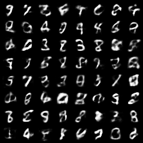
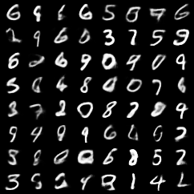
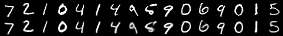

# VAE în PyTorch

Continuarea proiectului [VAE-from-scratch](https://github.com/SolomonStefan22/VAE-from-scratch), unde am scris în C++ un VAE pe MNIST, cu derivatele calculate de mână.

Aici am făcut trei lucruri:

1. **Am refăcut același model în PyTorch** (aceeași arhitectură, cost, inițializare și parametri) ca să verific derivatele scrise de mână. Rezultatele se potrivesc.
2. **Am construit un VAE convoluțional**, care vede imaginea ca 28 × 28, nu ca un șir de 784 de pixeli.
3. **Am măsurat cât de bune sunt cifrele generate**, cu un clasificator convoluțional (98,9% corect pe test).

## Rezultate

**C++ vs PyTorch** (același model, cost pe test după 5 epoci, în nați):

| Cod | C++ | PyTorch |
|-----|-----|---------|
| d = 2  | 158,48 | 159,95 |
| d = 16 | 109,45 | 109,01 |

**Liniar vs convoluțional** (d = 16, 1000 de cifre generate, judecate de clasificator):

|                         | Imagini reale | VAE liniar | VAE convoluțional |
|-------------------------|---------------|------------|-------------------|
| Cost pe test            | –             | 109,01     | **100,94**        |
| Încrederea medie        | 0,984         | 0,752      | **0,844**         |
| Cifre clare (peste 0,9) | 95,3%         | 35,9%      | **56,7%**         |
| Număr efectiv de cifre  | 9,92          | 9,54       | **9,82**          |

Modelul convoluțional face cifre mai clare și mai variate în același timp.

Cifre generate, liniar (stânga) și convoluțional (dreapta):

<p>
  
  
</p>

Reconstrucții cu modelul convoluțional (sus originalele, jos refacerile):



## Rulare

```sh
python -m venv .venv && source .venv/bin/activate
pip install -r requirements.txt
./download_mnist.sh

python train.py 16 mlp       # VAE liniar
python train.py 16 conv      # VAE convoluțional
python classifier.py         # clasificatorul
python evaluate.py 16 mlp conv
```

## Fișiere

- `mnist.py` – citirea fișierelor MNIST
- `vae.py` – cele două modele și costul (refacere + KL)
- `train.py` – antrenarea, salvează imagini în `results/` și modelul în `models/`
- `classifier.py` – clasificatorul
- `evaluate.py` – evaluarea cifrelor generate